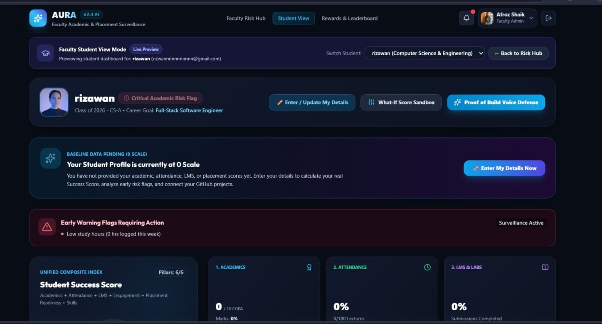
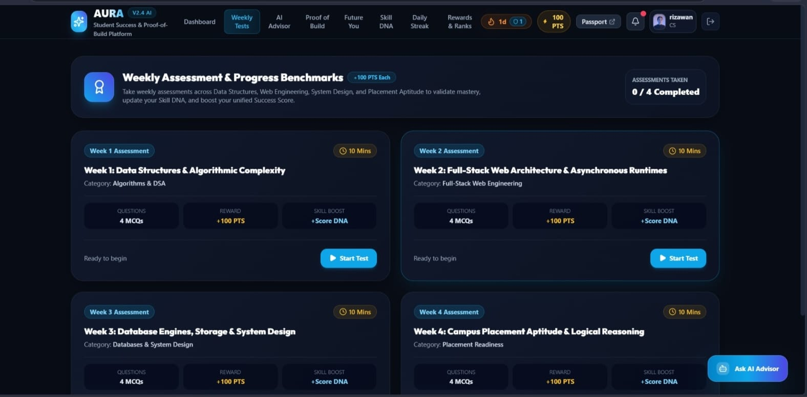
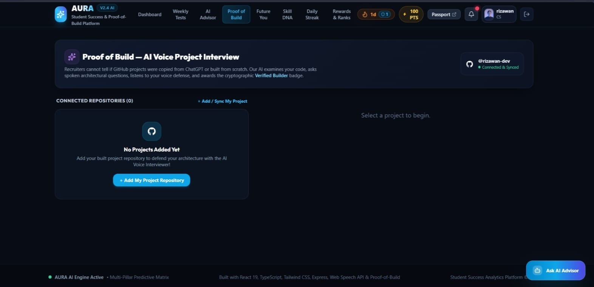
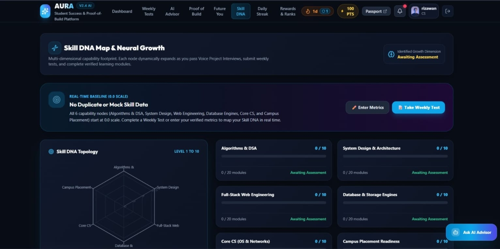
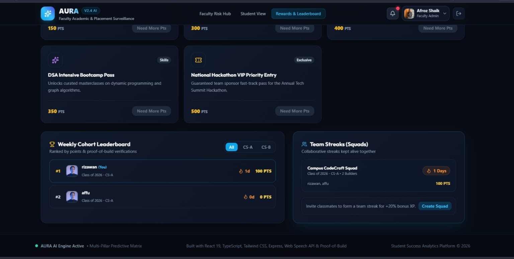

# 🚀 AURA v2.4 — Student Success Analytics Platform

AURA is a student success platform designed to help students monitor academic progress, build consistent learning habits, identify skill gaps, and showcase practical project knowledge.

## 🎯 Problem Statement

Traditional academic tracking may identify struggling students too late, while project submissions alone may not demonstrate a student's practical understanding. Students and educators need a unified platform to monitor performance, encourage consistent learning, and support career readiness.

**AURA v2.4** addresses these challenges through academic analytics, engagement tools, project-understanding assessments, skill development insights, and educator support.

## 💡 Problems Identified & Proposed Solutions

| Problem                                         | AURA Solution                                                                              |
| ----------------------------------------------- | ------------------------------------------------------------------------------------------ |
| Delayed identification of struggling students   | Academic indicators and early-warning alerts help identify students who may need support.  |
| Inconsistent study habits                       | Daily streaks, badges, reminders, and rewards encourage consistent learning.               |
| Difficulty assessing practical coding knowledge | Voice-based technical interviews explore students' understanding of their projects.        |
| Lack of personalized learning guidance          | Skill DNA highlights weaker competencies and suggests relevant learning topics.            |
| Unclear career readiness                        | Future You helps students explore career-preparation scenarios.                            |
| Difficulty monitoring student progress          | Educator Hub supports student monitoring and academic interventions.                       |
| Limited visibility into student achievements    | Skill Passport organizes project links, achievements, and available verification evidence. |

## ✨ Key Features

* **📊 Student Dashboard:** Academic indicators, success score, and progress tracking.
* **📈 Academic Analytics:** Performance trends, risk indicators, and what-if analysis.
* **🔥 Streaks & Rewards:** Daily engagement, badges, milestones, and streak-freeze tokens.
* **🎙️ Proof of Build:** Voice-based technical interviews about project implementation.
* **🧬 Skill DNA Map:** Competency visualization and learning recommendations.
* **🔮 Future You:** Career-preparation scenarios based on learning and project-related inputs.
* **🎓 Educator Hub:** Student monitoring, risk filters, and intervention support.
* **💼 Skill Passport:** A centralized view of project links, achievements, and available verification evidence.

## 🛠️ Tech Stack

| Category           | Technologies                  |
| ------------------ | ----------------------------- |
| Frontend           | React 19, TypeScript, Vite    |
| Styling            | Tailwind CSS, CSS Animations  |
| Data Visualization | Recharts                      |
| Icons & Effects    | Lucide Icons, Canvas Confetti |
| Backend            | Node.js, Express.js, REST API |
| Data Storage       | JSON File Storage             |
| Voice Features     | Web Speech API                |
| Tools              | Git, GitHub, npm              |

## 🖼️ Application Screenshots

Add actual screenshots of your application to the `docs/images/` folder and update the filenames below to match your files.

### 1. Student Dashboard



Shows academic indicators, success score, and student progress.

### 2. Academic Analytics



Displays academic trends, risk indicators, and what-if analysis.

### 3. Proof of Build



Demonstrates the voice-based project interview interface.

### 4. Skill DNA Map



Visualizes competency areas and learning recommendations.

### 5. Educator Hub



Shows student monitoring and available intervention tools.

## ⚙️ How to Run

**Prerequisites:** Node.js and npm installed.

### 1. Start the Backend

```bash
cd server
npm install
npm start
```

### 2. Start the Frontend

Open a new terminal:

```bash
cd client
npm install
npm run dev
```

### 3. Open the Application

Visit `http://localhost:5173` or the local URL displayed in your terminal.

## 🔮 Future Enhancements

* Integrate and validate predictive models using historical academic data.
* Introduce a database and secure authentication.
* Improve project verification and explainable interview scoring.
* Strengthen student privacy and accessibility.
* Add automated testing and deployment workflows.

## 👩‍💻 Author

**Shaik Rijwana**
Student Developer | AI & Full-Stack Web Development

**Project:** AURA v2.4 — Student Success Analytics Platform
